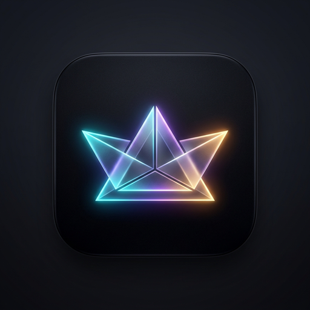
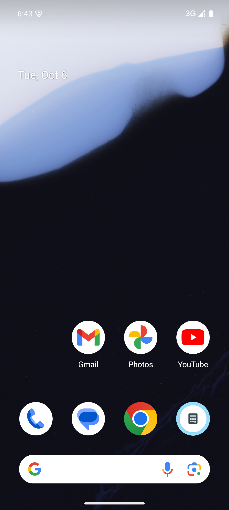
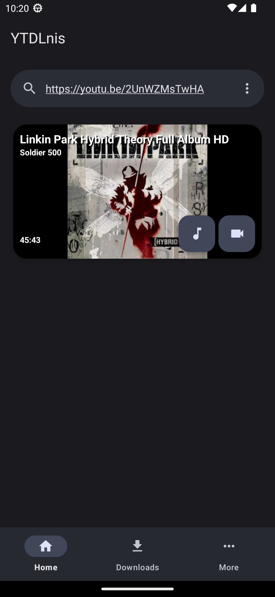
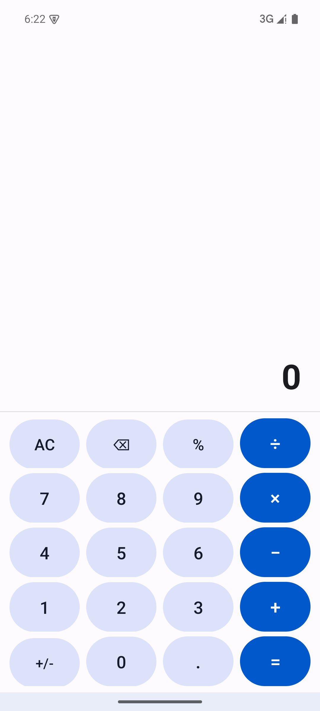
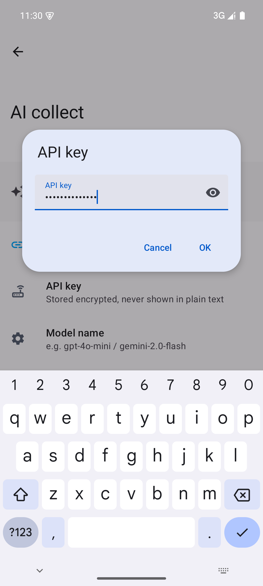

<div align="center">



# Lumen · KeZhou (刻舟)

### Carve fleeting waves into stone. A distraction-free, privacy-hardened media grabber and inspiration vault for AI visionaries and creators.

[](https://github.com/yukariamezawa-ai/kezhou/releases/latest)
[](https://github.com/yukariamezawa-ai/kezhou)
[](https://github.com/yukariamezawa-ai/kezhou/releases/latest)
[](https://github.com/yukariamezawa-ai/kezhou)
[](LICENSE)

<br/>

**[ 🇨🇳 简体中文 ](README.md)** &nbsp;|&nbsp; **[ 🇬🇧 English ](README-en.md)**

<br/>

**[ 📥 Download APK ](#-download--get-started)** &nbsp;•&nbsp; 
**[ ☕ Maker's Note ](#-a-note-from-the-maker)** &nbsp;•&nbsp; 
**[ ✨ Highlights ](#-what-lumen-does-for-you)** &nbsp;•&nbsp; 
**[ 💎 Free vs. Pro ](#-transparency-free-vs-pro)** &nbsp;•&nbsp; 
**[ ❓ FAQ ](#-frequently-asked-questions)**

---

</div>

## ☕ A Note from the Maker

We’ve all experienced this frustration:

- You're exploring Sora, Runway, Kling, or Twitter, and you stumble upon a mind-blowing camera move or a video clip you want to keep for reference;
- You search for a downloader, only to be ambushed by obnoxious interstitial ads, countdown timers, and an aggressive **"$9.99/month"** paywall after just two downloads;
- Worse yet, whenever you save personal or sensitive media, it gets dumped right onto the very top of your phone's main camera roll—leaving you in cold sweat whenever you hand your phone to a friend.

That is why I created **Lumen (刻舟)**.

I wanted a tool that **just works, with zero corporate trickery, built by a creator for creators**:
1. **Daily 1080P/720P high-speed saving is 100% free forever** — no "3-trial" traps, no bandwidth throttling;
2. **Personal media stays in a private bunker** — strictly invisible to Google Photos or gallery scanners, with desensitized notifications;
3. If you ever need pristine 4K/8K master streams or hardware-grade database encryption, you can **watch a 15-second sponsor video to unlock 24 hours of full Pro access**, or buy me a coffee for a lifetime pass.

Clean, respectful, and built to last.

---

## 📱 App Previews

<div align="center">
  <table>
    <tr>
      <td align="center" width="20%">
        <b>1. AI Hub & Discovery</b><br/>
        
      </td>
      <td align="center" width="20%">
        <b>2. Inspo Board & Shots</b><br/>
        
      </td>
      <td align="center" width="20%">
        <b>3. Detail & Vault Management</b><br/>
        
      </td>
      <td align="center" width="20%">
        <b>4. Decoy Calculator Lock</b><br/>
        
      </td>
      <td align="center" width="20%">
        <b>5. Pro Pass & Quota</b><br/>
        
      </td>
    </tr>
  </table>
</div>

---

## 🌟 What Lumen Does for You

### 🎬 1. Zero-Lag Shot Grabber & Prompt Studio
* **Native Hub for AI Communities**: One-tap gateways to Sora, Runway Gen-3, Kling AI, Pika, and Civitai with camera movement tags;
* **Floating Capture Capsule**: While watching any video in the built-in browser, tap the floating capsule to immediately grab high-res posters, authors, and sources without page reloads;
* **Prompt Studio**: Refine shots on the fly by injecting cinematic tags like `+dolly-in`, `+zoom`, `+tyndall-rays`, and `+cyberpunk`, and export formatted prompts directly into Midjourney or video generation tools.

### ⚡ 2. Generous Offline Saving (1080P / 720P 100% Free)
* **No Artificial Limits**: 1080P and 720P formats are completely unrestricted and free forever. No sneaky paywalls after a few uses;
* **Flexible Audio Extraction**: Extract clean background soundtracks directly into MP3, M4A, or lossless FLAC;
* **High-Speed Multi-Thread Engine**: Powered by industry-standard extraction architecture for smooth, uninterrupted background downloads.

### 🛡️ 3. KuroBox Vault: Never Panic When Lending Your Phone
* **Invisible to System Gallery**: Downloaded media is stored directly in an app-private sandbox with `.nomedia` guards. **Your system gallery, Google Photos, and messaging pickers will never detect them**;
* **Desensitized Notifications**: Progress notifications show only clean percentage bars with neutral text—never revealing video titles, sensitive URLs, or thumbnails;
* **Dual Secret Passcodes**: App icon and launcher mimic a harmless browser. The real vault entrance is concealed behind an address bar trigger (`kezhou://vault`) or tapping the version number 5 times, protected by your custom PIN.

---

## 💎 Transparency: Free vs. Pro

I despise tools that bait users with "free" promises only to turn around and hold their files hostage. Here are the exact ground rules:

| Feature | Base Tier (100% Free Forever) | Pro Pass (Ad Reward or Buy Me a Coffee) |
| :--- | :---: | :---: |
| **1080P / 720P High-Speed Saving** | ✅ **Unlimited & Free Forever** | ✅ **Unlimited & Free Forever** |
| **AI Inspo Grabber & Tagging** | ✅ **Full Access** | ✅ **Full Access** |
| **Prompt Studio (Kling / MJ / Runway)** | ✅ **Full Access** | ✅ **Full Access** |
| **Sandbox Isolation & .nomedia Guard** | ✅ **Enabled by Default** | ✅ **Enabled by Default** |
| **4K / 8K / 60FPS Pristine Streams** | ❌ (Capped at 1080P, great for phones) | 🌟 **Uncompressed Stream Muxing** |
| **KuroBox SQLCipher 256-bit Database** | Basic Anti-Prying | 🌟 **Full DB Encryption + Decoy Calculator** |
| **Ad-Free Clean Experience** | Minimal Sponsor Banner | 🌟 **100% Pure Ad-Free** |
| **How to Unlock** | **Instant, Zero Barriers** | **🎬 Watch 1 Sponsor Video = 24h Full Pro**<br/>*(Or voluntary lifetime coffee buyout)* |

> 💡 **Why are 4K and Vault Encryption in Pro?**  
> High-bitrate 4K stream muxing demands significant on-device compute and bandwidth, and website extraction rules change constantly, requiring weekly maintenance.  
> Offering a **"Watch an ad for a 24-hour Pro Pass"** model lets non-paying users enjoy everything without spending a cent, while generous supporters help cover server and coffee costs. It is the most honest, sustainable way to keep the project alive.

---

## 📥 Download & Get Started

Choose the APK tailored to your device's CPU architecture:

| Package (APK) | Architecture | Recommended For | File Size | Direct Download |
| :--- | :--- | :--- | :---: | :--- |
| **`KeZhou-1.9.0-arm64-v8a-release-github.apk`** | **arm64-v8a** | **Recommended (95%+ Modern Android Phones)** | **~67.1 MB** | [👉 Download](https://github.com/yukariamezawa-ai/kezhou/releases/download/v1.9.0/KeZhou-1.9.0-arm64-v8a-release-github.apk) |
| `KeZhou-1.9.0-universal-release-github.apk` | Universal All-in-One | Older phones or when architecture is unknown | ~207.2 MB | [👉 Download](https://github.com/yukariamezawa-ai/kezhou/releases/download/v1.9.0/KeZhou-1.9.0-universal-release-github.apk) |
| `KeZhou-1.9.0-armeabi-v7a-release-github.apk` | armeabi-v7a | Legacy 32-bit Android devices | ~56.4 MB | [👉 Download](https://github.com/yukariamezawa-ai/kezhou/releases/download/v1.9.0/KeZhou-1.9.0-armeabi-v7a-release-github.apk) |
| `KeZhou-1.9.0-x86_64-release-github.apk` | x86_64 | PC Android Emulators / ChromeOS | ~62.2 MB | [👉 Download](https://github.com/yukariamezawa-ai/kezhou/releases/download/v1.9.0/KeZhou-1.9.0-x86_64-release-github.apk) |
| `KeZhou-1.9.0-x86-release-github.apk` | x86 | Legacy 32-bit PC Emulators | ~61.5 MB | [👉 Download](https://github.com/yukariamezawa-ai/kezhou/releases/download/v1.9.0/KeZhou-1.9.0-x86-release-github.apk) |

<details>
<summary><b>🔍 View Package SHA-256 Checksums</b></summary>

```text
KeZhou-1.9.0-arm64-v8a-release-github.apk: 08FB6C60300A4F33CF2C136B8AC9BE929CD116C0FDA5DF01A0B5F62897A4246E
KeZhou-1.9.0-universal-release-github.apk: C5C7C64DC24B3BD76372BC4BB09CB5B51749439FB498E3E8E6DE4628B21149FE
KeZhou-1.9.0-armeabi-v7a-release-github.apk: DEB9FE650080DB12EF51251181DFCF100711A0D2048DBFC87D277DA5414EBB75
KeZhou-1.9.0-x86_64-release-github.apk: D69CEC23EB060EE785C22E906BD4F934C3606E55D77A1B7A0D6825C81E11408A
KeZhou-1.9.0-x86-release-github.apk: 75D67AAC251EFABBD695732BDB527CB067A6817DDC651DA45389F7BD7A4D40E4
```
</details>

---

## ❓ Frequently Asked Questions

<details>
<summary><b>Q1: Why can't I see saved videos in my system photos/gallery app?</b></summary>
<br/>
This is Lumen's primary privacy feature by design! When you save research clips or private inspiration, the last thing you want is for them to show up on your main camera roll when showing photos to colleagues or family. If you ever need to export a video to your public album, simply tap "Export to System Gallery" from the shot details page anytime.
</details>

<details>
<summary><b>Q2: Will you suddenly put basic features behind a paywall later?</b></summary>
<br/>
No. This project was born specifically out of frustration with greedy tools that lock up basic features after a few days. 1080P/720P saving, AI shot extraction, and prompt features will remain free forever.
</details>

<details>
<summary><b>Q3: Is the Android "Install from Unknown Sources" prompt safe?</b></summary>
<br/>
100% safe. Because official stores (like Google Play) ban video extraction tools by policy, any standalone APK distribution triggers Android's generic system prompt. All source code is auditable on GitHub, and releases pass strict static analysis checks.
</details>

---

## 📜 Acknowledgments & Disclaimer

- Based on and derived from the outstanding open-source project **[YTDLnis](https://github.com/deniscerri/ytdlnis)**, utilizing the battle-tested **yt-dlp** framework. Sincere gratitude to the open-source trailblazers who made this possible.
- Licensed under the **GNU General Public License v3.0 (GPLv3)**.
- **Disclaimer**: This software is intended solely for creators conducting local research, study, and legitimate personal media archiving. Please respect copyright laws and the intellectual property rights of original creators. Unauthorized commercial use or infringement is strictly prohibited.
